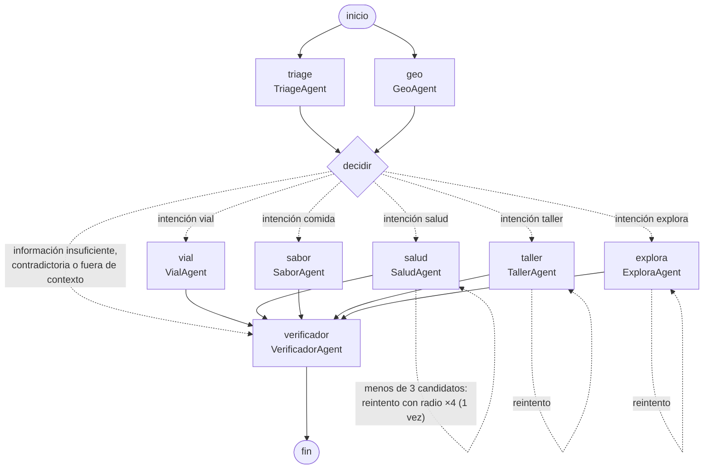
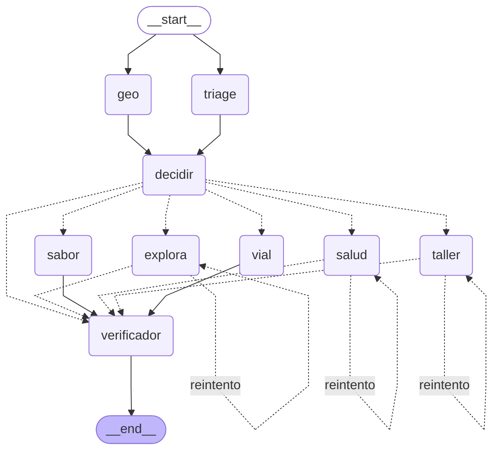

# Grafo del orquestador (LangGraph)

El orquestador de ORBIS está construido con **LangGraph** (`backend/app/orchestrator/pipeline.py`).
Cada agente es un **nodo** y el orden son **aristas**. Usa tres funciones de LangGraph:
nodos en **paralelo**, **aristas condicionales** y un **ciclo**.

## Vista explicada

- **Paralelo:** Triage y Geo arrancan al mismo tiempo (Geo no necesita nada del Triage) y se unen en el nodo `decidir`.
- **Arista condicional** (`decidir_ruta`): si hay contradicciones, falta información o la solicitud está fuera de contexto, el caso va directo al Verificador y no se ejecuta ninguna acción; si no, la intención elige el agente.
- **Ciclo de reintento** (`revisar_resultado`): Salud, Taller y Explora revisan cuántos candidatos encontraron sus herramientas **antes** de llamar al modelo. Si son menos de 3, piden al orquestador volver a ejecutarlos **una sola vez** con el radio ×4 (sin gastar una llamada a Gemini ni guardar acciones con un resultado pobre). Sabor no lo usa porque ya amplía su radio por dentro (2 → 8 → 25 km).
- Cada decisión del orquestador queda en la traza como `Orquestador (LangGraph)`.
- Flechas continuas: el paso siempre ocurre. Flechas punteadas: se toma una sola, según la condición.

## Ejemplo real del ciclo

"Tengo 2 horas libres, recomiéndame un recorrido turístico" desde Suba (`4.7569, -74.1147`):

1. ExploraAgent busca puntos de interés en 5 km → 0 candidatos → pide reintento.
2. Orquestador: `solo 0 candidatos encontrados: reintentar con radio ×4`.
3. ExploraAgent busca en 20 km → 4 candidatos → recorrido Museo del Oro, Plaza de Bolívar, Catedral Primada, Monserrate.
4. Orquestador: `4 lugares verificados` → Verificador.

## Diagrama generado por LangGraph

Generado automáticamente con `Pipeline().diagrama_mermaid()` (también en `GET /api/v1/orquestador/grafo`).
`draw_mermaid()` de LangGraph omite las aristas que vuelven al mismo nodo; `diagrama_mermaid()` las agrega (`-. reintento .->`).

